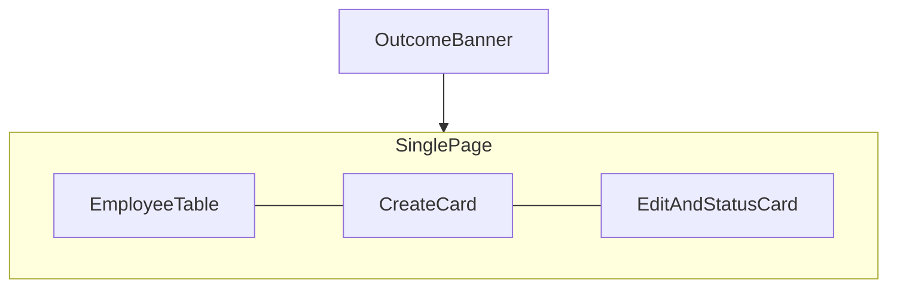

# Frontend Design

**Status:** Approved  
**Source:** `docs/requirements-package/06-ui-interaction-requirements.md`, `09-acceptance-criteria.md`, [06-api-design.md](06-api-design.md), [07-business-logic.md](07-business-logic.md)

## Purpose

The React single page for maintaining employees. Richer layout and visual treatment are a product choice for this design. There are still **no other screens**, no branded design system, and **no interactions beyond UI-1 through UI-7**.

Business rules in [07-business-logic.md](07-business-logic.md) still apply. Flask is the authority if the page and server disagree.

## Visual direction

- One page, English, readable type.
- Employee ID slightly muted so names and status stand out.
- Spacing, table, buttons, and chips via a small layout library or custom CSS. Not a branded theme.
- No avatars, dashboards, animations-as-a-feature, or a dark brand look.

## Layout (UI-1)

All of this is one page. No routes.

| Region | Contains |
|--------|----------|
| Top | Outcome banner (success or failure) |
| Left | Full employee table, or empty state in that region |
| Right, upper | Create card |
| Right, lower | Edit fields, activate, and deactivate for the current selection |

Create, edit, activate, deactivate, list, selection, and feedback stay on this page. No search, sort, filter, or paging controls.

## Load

When the page opens, it loads the full employee list (`GET /employees`). The table shows every record, active and inactive, with employee ID, first name, last name, and status (AC-1). If there are none, the left region shows the empty state and the create card stays available on the right (AC-2).

## Employee list (UI-2)

| Shown | Notes |
|-------|--------|
| Employee ID | Assigned by the tool; no create field for it; visually muted |
| First name | |
| Last name | |
| Status | **Active** or **Inactive** as a chip (see visual treatment) |
| Active and inactive | Same list, always |

## Selection (UI-3)

The user selects one row. Which row is selected is visible (highlight). Edit, activate, and deactivate apply to that record only (AC-3). Selection is page state only; it is not sent to the server as its own operation.

If nothing is selected, edit, activate, and deactivate have no employee to act on. This design does **not** add enable/disable rules beyond that.

## Create (UI-4)

- Card: first name, last name, and a submit control
- No employee ID field
- Submit calls `POST /employees` with first and last name only (no status; server defaults to **Active**)
- On success, the new row appears in the list as **Active** with an ID the user did not type (AC-4)
- Duplicate names are allowed; a second person with the same name is another row (AC-6)
- Blank or spaces-only names: no new row; the banner says what is missing (AC-5)

## Edit (UI-5)

- Card: first name and last name fields, filled with the selected employee’s current values
- Submit calls `PATCH /employees/{id}` with both names (API also allows a single name field; the page still sends both)
- On success, the list shows the new name and the same status (AC-7)
- Blank or spaces-only names: list unchanged; banner says what to correct

## Activate and deactivate (UI-6)

- Separate controls in the edit/status card, for the selected employee
- Activate calls `POST /employees/{id}/activate`. List status becomes **Active** (AC-8). Doing it again is not an error (AC-10)
- Deactivate calls `POST /employees/{id}/deactivate`. List status becomes **Inactive**. The row stays visible and selectable (AC-9). Doing it again is not an error (AC-10)

## Feedback (UI-7)

After create, edit, activate, or deactivate finishes, the banner shows whether it succeeded or failed (AC-12). One plain-language line. Use the server `message` on failure. The banner stays on the page; it is not a toast that disappears before it can be read.

## Access on the page (AC-11)

The page does not add permission checks. Anyone who can open it can create, edit, activate, and deactivate.

## Visual treatment

| Element | Treatment |
|---------|-----------|
| List | Table. Comfortable row height. ID muted; names and status more prominent. |
| Selected row | High-contrast background and a left edge so AC-3 is obvious. |
| Status | **Active** and **Inactive** as readable pills with distinct color, not only unstyled text. Both statuses remain in the same list. |
| Empty list | Heading and sentence: “No employees yet.” Create card still on the page. No illustration required. |
| Create / edit | Cards grouping fields and submit so the two actions are easy to scan. |
| Activate / deactivate | Two distinct controls in the edit/status card. |
| Outcome | Banner at the top with background and a status-message role. Success and failure distinguishable. |

## Out of this design

- Other pages or routes as a product feature
- Hiding inactive employees by default (open question)
- Search, sort, filter, paging, undo, delete
- Disable-until-select, keyboard shortcuts, confirm dialogs, disappearing toasts
- Avatars, org charts, dashboards, drag-and-drop, command palette, filter tabs, bulk actions
- Branded or dark “theme” as a product identity
- Dedicated mobile app; additional languages

## Related design documents

- [06-api-design.md](06-api-design.md)
- [07-business-logic.md](07-business-logic.md)

## Traceability

| UI section | Requirement IDs |
|------------|-----------------|
| Single page | UI-1 |
| List and empty state | UI-2, FR-1, AC-1, AC-2 |
| Selection | UI-3, FR-2, AC-3 |
| Create | UI-4, FR-3, AC-4, AC-5, AC-6 |
| Edit | UI-5, FR-4, AC-7 |
| Activate and deactivate | UI-6, FR-5, FR-6, AC-8, AC-9, AC-10 |
| Feedback | UI-7, AC-12 |
| Equal access | FR-7, AC-11 |
