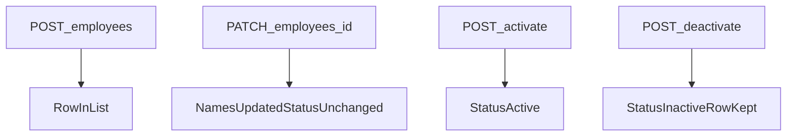

# Business Logic

**Status:** Approved  
**Folder:** Experience  
**Source:** `docs/requirements-package/07-business-rules-validation.md`, `05-functional-requirements.md`, [api-design.md](../Core%20design/api-design.md)

## Purpose

Implementation rules for employee operations: which endpoint runs, which fields are in, which checks run, and what is stored. Flask is the authority. The React page must not contradict these rules. Redundant with API and backend by design.

## Employee record (after any successful write)

| Field | Source | Constraints |
|-------|--------|-------------|
| `id` | Assigned by the store at create | Unique; permanent; never in a successful create body as the stored value; never edited |
| `firstName` | Create required; edit if present in the request | After trim, not empty |
| `lastName` | Create required; edit if present in the request | After trim, not empty |
| `status` | Create optional in API (default **Active**); otherwise only activate/deactivate | Only `Active` or `Inactive` |

JSON names match [api-design.md](../Core%20design/api-design.md). Duplicate `firstName` + `lastName` is allowed. `id` distinguishes rows.

## Shared checks

Apply in this order unless an operation says otherwise. On any failed check: **do not persist**; return a plain `message` (BR-8, UI-7).

| ID | Check | Fail when |
|----|--------|-----------|
| C1 | Trim names | (not a fail) Strip leading and trailing spaces on any name that is present before other name checks |
| C2 | Create names present | `firstName` or `lastName` missing, or empty after trim (BR-1) |
| C3 | Edit names | No name field in the body, **or** a name field is present and empty after trim. Omitted name fields are left unchanged (FR-4). A present blank/spaces field fails (BR-1) |
| C4 | Employee ID on create | If `id` is in the create body, ignore it. Do not store a client-chosen id (BR-2) |
| C5 | Create status | If `status` is omitted, store **Active**. If present, it must be `Active` or `Inactive` (FR-3, BR-4). Any other value fails; nothing stored |
| C6 | Duplicate names | Never fail for matching names (BR-3) |
| C7 | Record exists | Path `id` does not match a stored employee |
| C8 | Edit does not set status | If `status` is in the edit body, ignore it. Do not change status (BR-5) |
| C9 | Activate/deactivate do not set names | Ignore name fields if sent. Do not change names (BR-5) |
| C10 | Repeat status | Already Active + activate, or already Inactive + deactivate → success, row unchanged except still committed as that status (BR-6) |

There is no delete. Deactivate only changes status (BR-7).

Select is **not** a business operation and has **no** endpoint. The page holds the selected `id` and passes it on edit, activate, and deactivate.

## Operations mapped to API

### List

| | |
|--|--|
| Endpoint | `GET /employees` |
| Input | None |
| Checks | None |
| Persist | None |
| Result | Every employee, Active and Inactive: `id`, `firstName`, `lastName`, `status`. Empty list is success with no rows. No paging, filter, or sort rule. |

### Create

| | |
|--|--|
| Endpoint | `POST /employees` |
| Input | `firstName`, `lastName` required. `status` optional (`Active` or `Inactive`). `id` ignored if sent. |
| Checks | C1, C2, C4, C5, C6 |
| Persist | New row. `id` assigned by the store. Names stored trimmed. Status from C5. |
| Result | The new employee, including assigned `id`. Default UI path (no status in the form) yields **Active** (AC-4). |

The React create form still sends names only. Other callers may send `status`.

### Edit

| | |
|--|--|
| Endpoint | `PATCH /employees/{id}` |
| Input | Path `id`. Body: `firstName` and/or `lastName`. At least one name field must be present. `status` and `id` in the body are ignored. |
| Checks | C7 first (unknown id → no write). Then C1, C3, C6, C8 |
| Persist | Only the name fields that were present. Other name and status stay as stored. |
| Result | Full employee with updated name(s) and unchanged status (AC-7). |

The React edit form still submits both fields pre-filled. The API may accept a single name field.

### Activate

| | |
|--|--|
| Endpoint | `POST /employees/{id}/activate` |
| Input | Path `id`. No body required. C9 if a body is sent. |
| Checks | C7, C9, C10 |
| Persist | `status` = `Active`. Names unchanged. |
| Result | Full employee with `status` Active. Repeat activate is success (AC-10). |

### Deactivate

| | |
|--|--|
| Endpoint | `POST /employees/{id}/deactivate` |
| Input | Path `id`. No body required. C9 if a body is sent. |
| Checks | C7, C9, C10 |
| Persist | `status` = `Inactive`. Names unchanged. Row not removed. |
| Result | Full employee with `status` Inactive. Still returned by list and usable for edit or activate (AC-9). Repeat deactivate is success (AC-10). |

## Flows

## Equal access

No extra permission check on these operations (FR-7). Authorization to reach the tool is outside this logic.

## Out of this design

- Delete
- Approvals
- Undo / restore previous version
- Rehire policy (open question)
- Max name length or character-set rules beyond trim and non-empty
- List order

## Related design documents

- [../Core design/api-design.md](../Core%20design/api-design.md)
- [../Core design/backend-design.md](../Core%20design/backend-design.md)
- [frontend-design.md](frontend-design.md)

## Traceability

| Rule | Requirement IDs |
|------|-----------------|
| Required / trimmed names | BR-1, AC-5 |
| Employee ID | BR-2, FR-3 |
| Duplicate names | BR-3, AC-6 |
| Status values and create default | BR-4, FR-3 |
| Optional status on create | FR-3 |
| Partial edit | FR-4, BR-1 |
| Edit vs activate/deactivate | BR-5, AC-7 |
| Repeat status | BR-6, AC-10 |
| Deactivate keeps row | BR-7, FR-6, AC-9 |
| Failed write | BR-8 |
| Endpoints | API design, FR-1 through FR-6 |
