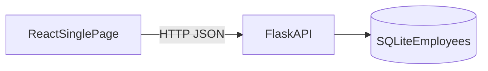

# Solution Architecture

**Status:** Draft  
**Folder:** Foundation  
**Source:** Approved requirements package; locked stack (Python / Flask, React, SQLite); caller already authorized

## Purpose

This document defines the runtime shape of the employee list tool: what runs where, how the pieces talk, and which rules are architectural (they constrain later DB, API, UI, and security docs). It does not specify table DDL, HTTP paths, or control layout; those belong in Core design and Experience.

## Context

Staff who maintain employee information need one current list of people and whether each person is **Active** or **Inactive**. This release is that list plus create, name edit, activate, and deactivate. It is not broader HR administration.

Requirements that fix the shape of the system:

- There is **one shared list** for the whole organization, not a list per user or team.
- The list **starts empty**. Current employees are added one create at a time.
- **Authorization to reach the tool is outside this capability.** Anyone who can use the tool may perform every supported operation (FR-7, NFR-6).
- The user interface is **one page** (UI-1). There is no screen-to-screen navigation.
- Records **persist**. A change reported as successful is still present after a later visit or a restart (NFR-4).
- More than one user may maintain the list at the same time (NFR-5).
- Employee names are personal information (NFR-7).

This architecture does **not** answer open questions (bulk import, HR/payroll ID meaning, rehire, search/filter, audit trail, hiding inactives). Those remain open and are not designed here.

## Logical view

Three parts. No other application tiers.



| Part | What it is | Why it exists |
|------|------------|---------------|
| React single page | The only user-facing surface | UI-1: list and all maintenance actions on one page |
| Flask API | The only place that validates, assigns IDs, and applies status changes | FR-3–FR-6, BR-1–BR-8; one shared list for all users |
| SQLite | The only store of employee records | NFR-4 durability; one org-wide list |

There is no identity service, no HR/payroll connection, no reporting store, and no separate “selection” service.

## Runtime flow

```mermaid
sequenceDiagram
  participant User
  participant Page as ReactSinglePage
  participant API as FlaskAPI
  participant DB as SQLite

  User->>Page: Open tool
  Page->>API: Load all employees
  API->>DB: Read all rows
  API-->>Page: Full list
  Page-->>User: Table or empty state

  User->>Page: Create, edit, activate, or deactivate
  Page->>API: Corresponding write
  API->>API: Validate
  alt Rejected
    API-->>Page: Failure message
    Page-->>User: Outcome text; list unchanged
  else Accepted
    API->>DB: Atomic write
    DB-->>API: Committed
    API-->>Page: Success and updated record or list
    Page-->>User: Outcome text; list reflects change
  end
```

Select (FR-2, UI-3) never appears in this sequence as a server call. The page remembers which row is selected and uses that ID on edit, activate, and deactivate.

## Components

| Component | Responsibility | Not responsible for |
|-----------|----------------|---------------------|
| React single page | Show every employee (id, first name, last name, status). Show empty when there are none. Make selection visible. Create form (first and last name only). Edit fields pre-filled from the selection. Activate and deactivate controls. Plain success/failure text. | Other pages or routes as a product feature. Search, sort, filter, paging. Hiding inactive rows. Assigning employee IDs. Enforcing business rules that must hold for all users. Sign-in. Branding. |
| Flask API | Return the full list. Create with system-assigned ID and status **Active**. Update name without changing status. Set status via activate/deactivate without changing name. Reject invalid create/edit with no persist. Treat repeat activate/deactivate as success. | Delete. Bulk import/export. Matching an external HR number. Role checks. Approvals. Audit of who changed what. |
| SQLite | Hold one employee row per person: ID, first name, last name, status. Keep IDs unique and permanent. Survive process restart. | Extra attributes. Physical delete as a product function. Per-user lists. |

## Key architectural rules

These are binding on later design documents.

1. **Single page, full list.** The page loads and displays all employees, active and inactive together, with no paging (UI-1, UI-2, NFR-2). Empty is a valid state, not an error (AC-2).

2. **Selection is client state.** Choosing a row only decides which ID later writes apply to. The server does not have a “selected employee” resource (FR-2, UI-3).

3. **The tool assigns employee ID.** The client never submits an ID on create. The ID is unique, never changes, cannot be edited, and is shown in the list (FR-3, UI-2, UI-4, BR-2). It is not designed as an HR or payroll number.

4. **Create is names only, status Active.** UI-4 has no status field. New records are **Active** (FR-3, BR-4). Duplicate names are allowed (BR-3).

5. **Name and status are separate writes.** Edit changes first and/or last name only. Activate sets **Active**. Deactivate sets **Inactive**. Activate/deactivate do not change the name (FR-4–FR-6, BR-5). Repeat status change is not an error (BR-6).

6. **Deactivate is not delete.** Inactive rows stay in the store and in the list and stay selectable (FR-6, BR-7). There is no delete path.

7. **Validation is server-side and all-or-nothing.** Missing or whitespace-only names are rejected. Nothing is saved. The user is told what to correct (BR-1, BR-8, UI-7). The page may also check before submit for NFR-1, but the API is the authority.

8. **Success means committed.** If the tool reports success, the row is in SQLite and will still be there after restart or a later visit (NFR-4). A failed create/edit must not leave a partial row.

9. **Equal functions for every caller who can reach the API.** No role dimension in this architecture (FR-7, NFR-6). Reachability is assumed to be enforced outside (see Security Design).

10. **One shared database file/schema for the organization.** Not a database per browser user.

## Data on the wire (architectural, not the API spec)

Enough to keep later API design inside the requirements:

- List payload: every employee with employee ID, first name, last name, status.
- Create payload: first name, last name.
- Edit payload: first name and/or last name for a known ID.
- Activate / deactivate: identity of the employee only; no name fields.
- Outcome: enough for the page to show success or failure in plain text (UI-7).

No other resources.

## Quality attributes

| NFR | Architectural response |
|-----|------------------------|
| NFR-1 Simplicity of use | One page; obvious list, form, and status controls; no training-only workflows; plain functional UI. |
| NFR-2 Scale | Hundreds of rows on one page. No paging, search, or filter in this architecture. Flask returns the full list; React renders the full table. |
| NFR-3 Responsiveness | Three-tier path is short: page → one Flask request → one SQLite read or write. Target: list load and each maintenance action feel immediate (a few seconds at most). |
| NFR-4 Durability | SQLite is the system of record. Flask commits before returning success. Restarting Flask or the browser does not reset the list. |
| NFR-5 Concurrent use | Multiple browsers may call Flask at once. Each create/edit/activate/deactivate is one atomic SQLite transaction so a record cannot be half-written. A response of success is only sent after commit, so a saved change is not silently dropped. No merge or undo UI (out of scope). |
| NFR-6 Access control | Not implemented in these three components. This design assumes the caller is already authorized. Flask does not add a second permission model. |
| NFR-7 Personal data | First and last name are stored and shown because the requirements require them. No additional personal attributes. Handling follows the organization's data protection policy (detail in Security Design). |
| NFR-8 Availability | Intended for normal business hours. No extra high-availability topology or uptime SLA in this release. |

## What this architecture excludes

Aligned with `docs/requirements-package/11-out-of-scope.md`:

- Extra employee attributes; extra name parts
- Delete, bulk import/export, search/sort/filter/paging, undo
- Roles, approvals, in-app accounts/sign-in, audit trail
- HR/payroll/directory integration, reports, notifications
- Visual design system, dedicated mobile app, additional languages

## Related design documents

- [tech-stack.md](tech-stack.md)
- [solution-overview.md](solution-overview.md) (scaffold; not the source of these rules)
- [../Core design/db-design.md](../Core%20design/db-design.md)
- [../Core design/backend-design.md](../Core%20design/backend-design.md)
- [../Core design/api-design.md](../Core%20design/api-design.md)
- [../Experience/frontend-design.md](../Experience/frontend-design.md)
- [../Experience/security-design.md](../Experience/security-design.md)

## Traceability

| Design section | Requirement IDs |
|----------------|-----------------|
| Context and shared list | Executive summary, persona, assumptions |
| Three components | UI-1, FR-1, NFR-4 |
| Selection not on the server | FR-2, UI-3 |
| ID assignment and display | FR-3, UI-2, UI-4, BR-2 |
| Create / edit / activate / deactivate split | FR-3–FR-6, BR-4, BR-5, BR-6, BR-7 |
| Validation and feedback | BR-1, BR-8, UI-7 |
| Equal access / auth outside | FR-7, user access, NFR-6 |
| Full list, no paging | FR-1, UI-2, NFR-2 |
| Quality attributes | NFR-1–NFR-8 |
| Exclusions | Out of scope; open questions left open |
