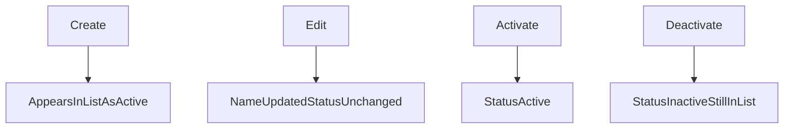

# Business Logic

**Status:** Scaffold  
**Folder:** Experience  
**Source:** `requirements package/07-business-rules-validation.md`, `05-functional-requirements.md`

## Purpose

State the domain rules in one place so backend, API, and UI apply the same behavior.

## Record rules

### Names

<!-- BR-1: first and last name required; missing or only spaces rejected. -->

### Employee ID

<!-- BR-2: unique, assigned at create, never changes, not editable. -->

### Duplicate names

<!-- BR-3: allowed. ID distinguishes records. -->

### Status

<!-- BR-4: Active or Inactive only. New employee is Active. -->

## Operation rules

### Create

<!-- FR-3. After create, record appears in the list and is selectable. -->

### Edit

<!-- FR-4. Name only. Does not change status. -->

### Activate

<!-- FR-5. Sets Active. Repeat is harmless (BR-6). -->

### Deactivate

<!-- FR-6. Sets Inactive. Not deletion (BR-7). Remains visible and selectable. Repeat is harmless (BR-6). -->

### Failed create or edit

<!-- BR-8: no part of the change is saved; user is told what to correct. -->

## Flows

## Out of this design

- Delete
- Approvals
- Undo / restore previous version
- Rehire policy (open question)

## Related design documents

- [../Core design/backend-design.md](../Core%20design/backend-design.md)
- [frontend-design.md](frontend-design.md)

## Traceability

| Rule | Requirement IDs |
|------|-----------------|
| | BR-1 through BR-8, FR-3 through FR-6 |
