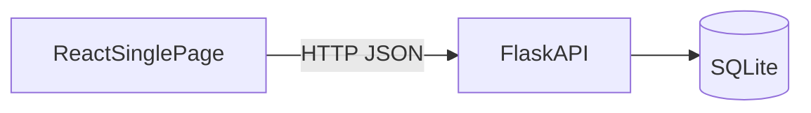

# Solution Overview

**Status:** Draft  
**Folder:** Foundation  
**Source:** Approved requirements package plus the rest of this solution design

## Purpose

A short picture of the whole solution: who it is for, what this release does, and how the other design documents fit. Details live in those documents, not here.

## Problem

Organizations need a current list of employees and whether each person is **Active** or **Inactive**. Out-of-date records make it unclear who is still with the organization and who should be included in day-to-day work.

## Solution in this release

One shared employee list for the whole organization. Staff add people, correct names, and set Active or Inactive. Everyone who can use the tool can do all of that. The list starts empty; people are added one create at a time.

This is employee basics only, not broader HR administration.

## Users

One persona: **employee record maintainer**. Viewers and maintainers are the same people.

### Goals

- Add new hires and people already in the organization
- Populate the initial roster through create
- Correct first and last names
- Mark Active or Inactive
- Find and update a record from a single list

## Capabilities

| Activity               | In this release                                                 |
| ---------------------- | --------------------------------------------------------------- |
| View the employee list | Yes — all rows, Active and Inactive, on one page                |
| Select an employee     | Yes — page state only, not an API                               |
| Create an employee     | Yes — names required; optional API `status`, default **Active** |
| Edit an employee name  | Yes — one or both names; status unchanged                       |
| Activate an employee   | Yes — repeat is not an error                                    |
| Deactivate an employee | Yes — row stays; not delete; repeat is not an error             |

## How it is built (gist)

| Area         | Gist                                                                                                                             | Document                                                               |
| ------------ | -------------------------------------------------------------------------------------------------------------------------------- | ---------------------------------------------------------------------- |
| Architecture | React page → Flask → SQLite. Success means committed. Auth outside.                                                              | [solution-architecture.md](solution-architecture.md)                   |
| Stack        | Python 3.14.7, Flask 3.1.3, React 19.3.0, Vite 8.3.0, Node 22 LTS, SQLite via `sqlite3`, Flask-Cors 6.0.5, custom CSS            | [tech-stack.md](tech-stack.md)                                         |
| Data         | One employee: ID (store-assigned), first name, last name, status Active/Inactive. Duplicate names allowed. No delete.            | [../Core design/db-design.md](../Core%20design/db-design.md)           |
| Backend      | Flask validates, assigns ID, writes SQLite. No roles. No selected-employee on the server.                                        | [../Core design/backend-design.md](../Core%20design/backend-design.md) |
| API          | `GET/POST /employees`, `PATCH /employees/{id}`, `POST .../activate`, `POST .../deactivate`                                       | [../Core design/api-design.md](../Core%20design/api-design.md)         |
| Rules        | Checks C1–C10: trim names, create/edit validation, optional create status, partial edit, activate/deactivate do not change names | [../Experience/business-logic.md](../Experience/business-logic.md)     |
| UI           | One page: banner, table (or empty), create card, edit/status card. Status chips, selected-row highlight. Same five operations.   | [../Experience/frontend-design.md](../Experience/frontend-design.md)   |
| Access       | Caller already authorized. Equal rights. Names are personal data (org policy).                                                   | [../Experience/security-design.md](../Experience/security-design.md)   |
| Tests        | Prove AC-1–AC-12 (and BR/NFR those criteria need).                                                                               | [../Operations/testing-strategy.md](../Operations/testing-strategy.md) |

## What this release is not

Delete, bulk import/export, search/sort/filter/paging, undo, extra employee attributes, roles, approvals, in-app sign-in, audit trail, HR integrations, reports, notifications, branded design system, dedicated mobile app, extra languages.

Open questions stay open: bulk load, HR/payroll ID meaning, rehire vs new row, search later, audit trail, hiding inactives.

## Related design documents

- [tech-stack.md](tech-stack.md)
- [solution-architecture.md](solution-architecture.md)
- [../README.md](../README.md)

## Traceability

| Design section         | Requirement IDs                      |
| ---------------------- | ------------------------------------ |
| Problem and solution   | Executive summary                    |
| Users and goals        | Persona                              |
| Equal capabilities     | User access, FR-7                    |
| Four operations + list | FR-1–FR-6                            |
| Data gist              | Data requirements, BR-2–BR-4         |
| Out of scope           | `11-out-of-scope.md`, open questions |

